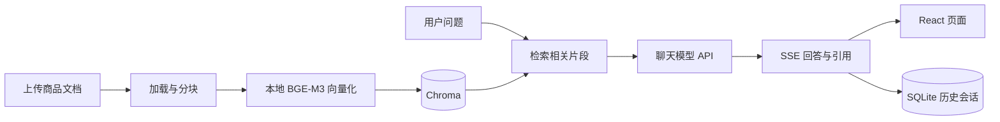

# 电商知识库问答 · AI 辅助实践

**FastAPI / React / LangChain / Chroma / 本地 BGE-M3**

围绕“上传商品资料 → 查找相关内容 → 生成带来源的回答 → 保存历史会话”的需求，在 AI 辅助下完成本地运行适配、模型接入、问答验证与展示整理。可用于演示商品参数查询、使用注意事项和售后规则问答。

**不用安装也能查看效果：** [完整问答记录](snapshots/20261029/conversations.md) · [商品与售后资料](sample_data/demo_products.md) · [一次改进前后的对比](docs/ITERATION.md)

**运行项目：** [安装与恢复步骤](docs/SETUP.md) · [模型下载](https://github.com/2672232769/ecommerce-rag-showcase/releases/tag/local-snapshot-20261029) · [验证记录](docs/VERIFICATION.md)

## 现有演示

仓库保留 **3 个会话、16 条历史消息、1 份商品资料、2 个向量片段**，包括回答正文、引用片段、SQLite 数据和 Chroma 索引。以下为已有记录中的示例；全文及引用可直接点开上面的记录查看。

| 问题 | 已保存的回答内容 |
| --- | --- |
| 星河 K87 多少钱？支持哪些连接方式？ | 299 元；USB-C 有线、蓝牙、2.4 GHz 无线 |
| 非质量问题退货，谁承担运费？ | 买家承担运费 |
| 海风 T500 保温杯能放进微波炉吗？ | “根据知识库信息，**海风 T500 保温杯禁止使用微波炉加热**。” |
| 星河 K87 有几个颜色？ | “知识库中未提供星河 K87 机械键盘的颜色信息，建议您联系人工客服进一步确认。” |

前两行是回答摘要，后两行为改进提示词后的原回答。商品资料为虚构演示数据；这些问答来自已保存的真实模型调用记录，不是本次为了展示手写的模型回答。旧版冗长回答和不充分依据的扩展也保留在完整记录中。

## 功能

- 用户注册、登录、修改密码，管理员与普通用户区分。
- 管理员上传 TXT、Markdown、PDF、CSV；后台加载、分块、向量化并写入知识库。
- 检索相关片段后调用兼容 OpenAI 协议的聊天服务，SSE 流式返回正文与来源。
- 为用户保存独立的多个会话；历史消息和引用写入 SQLite。
- 本地 BGE-M3 ONNX INT8 生成 1024 维稠密向量，Chroma 持久化保存。
- 快照导出、完整性校验和恢复；换电脑后可以继续查看已有知识库与会话。

## 数据流



## AI 协作与已完成的改动

项目采用需求驱动的 AI 协作方式：我提出运行与展示需求、试用反馈并决定后续方向；AI 协助代码修改、环境配置、问题排查和验证。

在已有项目基础上，当前版本完成的工作包括：

- Windows 独立环境、前后端统一启动入口和浏览器路由刷新回退。
- 修复异步 SQLite 连接池与依赖版本兼容问题，固定可用依赖。
- 接入本地 ONNX 向量模型与外部聊天服务，并区分两者配置。
- 处理文档同名覆盖、文件名越界和模型调用失败时的错误反馈。
- 用真实商品问答检查来源与答案；根据发现的问题收紧提示词。
- 增加隔离测试，以及可恢复的数据快照、完整聊天导出和模型校验信息。

具体示例见 [改进记录](docs/ITERATION.md)，代码来源与职责边界集中记录在 [来源说明](docs/PROVENANCE.md)。

## 代码与数据导航

| 内容 | 位置 |
| --- | --- |
| FastAPI 接口、认证与持久化 | `backend/app/` |
| RAG 检索与生成 | `backend/app/rag.py` |
| 本地向量推理 | `backend/app/local_embeddings.py` |
| React 页面 | `frontend/src/` |
| 隔离测试 | `backend/tests/` |
| 完整会话与引用 | [Markdown](snapshots/20261029/conversations.md) / [JSON](snapshots/20261029/conversations.json) |
| SQLite、Chroma、上传资料 | [data.zip](snapshots/20261029/data.zip) |
| 已构建前端 | [frontend-dist.zip](snapshots/20261029/frontend-dist.zip) |
| 快照清单与校验值 | [manifest.json](snapshots/20261029/manifest.json) |

这些数据经项目所有者授权公开。会话正文、引用、归属和知识库保持完整；只排除实际登录凭据、API/JWT 密钥与运行日志。恢复时设置自己的登录密码。这里的聊天指项目网页内的问答，不包含 Codex 聊天历史。

## 本地运行

```powershell
git clone https://github.com/2672232769/ecommerce-rag-showcase.git
cd ecommerce-rag-showcase
.\setup_local.bat
```

继续按 [安装与恢复步骤](docs/SETUP.md) 创建配置、下载模型、恢复快照，然后执行 `start_local.bat`，打开 `http://127.0.0.1:8018/`。

阅读仓库中的问答记录无需 API 密钥。启动应用需要本地依赖和配置；生成新回答需要自己的聊天服务 API 密钥。仓库不会提供可用的付费服务凭据。

## 当前范围

- 目前演示库规模很小，样例验证不代表普遍准确率或大规模检索效果。
- 会话历史会保存，但当前生成提示词不使用历史消息进行指代消解。
- TXT/Markdown 是主要已验证格式；PDF/CSV 有实现，完整兼容性仍需补验。
- 当前采用稠密向量检索，没有加入重排、混合检索或知识图谱。
- 这是本地演示项目，尚未进行生产负载与公网部署验收。

## 来源

基础代码参考 [Manchenlin/Itcast_dianshang_RAG_vibeCoding](https://github.com/Manchenlin/Itcast_dianshang_RAG_vibeCoding)，在此基础上进行 AI 辅助适配与完善；模型使用 BAAI BGE-M3 的 ONNX INT8 转换版本。详细版本、来源与许可信息见 [PROVENANCE.md](docs/PROVENANCE.md)。
